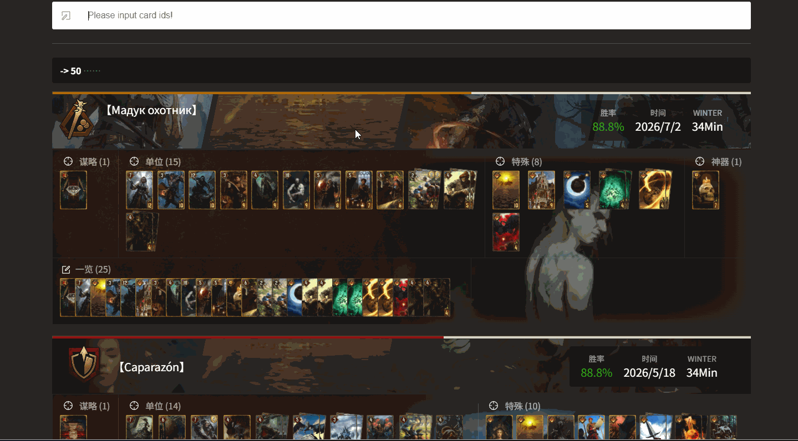
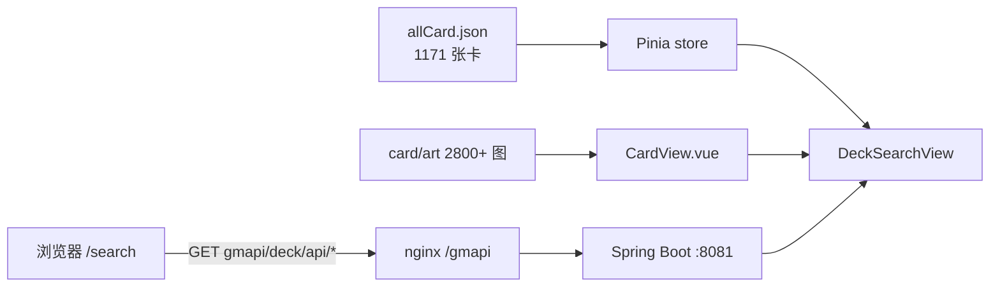

# GwentMirror · 昆特牌卡组站

**点几张牌 → 只显示「包含这些牌」的卡组 → 点开看完整构筑。**

昆特牌没有官方卡组检索，玩家只能翻论坛截图对牌。
这个站点把牌库摊开：1171 张卡的下拉、虚拟滚动的卡组列表、按卡牌包含过滤，
卡图与卡牌数据全部打包进前端，官网挂了也能正常看。

   

站点演示（选牌 → 过滤 → 卡组详情，42 帧）：



↑ 顶部选牌，命中数从 50 变成 15，被选中的牌在每套卡组里带橙色虚线框。

## 这是什么

1. 打开就是 50 套随机卡组（取「比当前版本更新」的那批），不用登录；
2. 点输入框展开 1171 张卡的下拉，选中的牌变成输入框左边的小卡牌 token；
3. 选完自动请求后端，列表只剩包含这些牌的卡组；悬停任意卡牌浮出技能大图。

数据来自同项目的 [Spring Boot 服务](https://github.com/1053278842/GwentMirrorService)，
接口统一走 `/gmapi` 反代。

## 能干什么

- **不靠记牌名找牌** —— 卡牌下拉支持按名称过滤，选中的牌在结果里高亮描边
- **一次选多张** —— 选几张就要求「同时包含」，命中数实时收敛
- **上千套也不卡** —— 卡组列表用 `DynamicScroller` 虚拟滚动，只渲染可视区
- **卡图离线可用** —— 2800+ 张卡图、卡框、势力背景都打进产物，不依赖官网接口
- **手绘卡面** —— `CardView.vue` 用 CSS 拼卡框/战力/人口/稀有度，悬停出大图

## Quick Start

```bash
# 只想看效果：整个站点已经打包在镜像里，起来就有 477 套样例卡组
docker run -d --name gwent-mirror -p 8080:80 \
  crpi-jjrtzj5uuz1ioat1.cn-shanghai.personal.cr.aliyuncs.com/liunidie/gwentmirror-all-in-one:1.4.0
# 打开 http://localhost:8080
```

改前端代码：

```bash
npm install && npm run dev      # http://localhost:5173，需后端在 8081
```

`/gmapi` 默认指向作者的线上后端，本地调试要改 `vite.config.ts`（见
[docs/getting-started.md](docs/getting-started.md)）。

## 用起来是什么样

| 路由 | 组件 | 说明 |
| --- | --- | --- |
| `/` | — | 重定向到 `/search` |
| `/search` | `DeckSearchView.vue` | 主页：卡牌检索栏 + 卡组虚拟滚动列表 |
| `/home` | `HomeView.vue` | 早期原型：直接罗列几张卡（无样式） |
| `/about` | `AboutView.vue` | 原型页 |
| `/test` | `手写固定高虚拟列表论文用.vue` | 虚拟列表实验页 |

## 怎么实现的



- **数据**：卡牌表 `allCard.json` 打包进产物，卡组列表来自后端；两张卡图走 `/src/assets` 绝对路径
- **交互**：选牌写进 `UserOperationStore`，拼成 `ids=1,2,3` 请求后端，返回的卡组再做分组与排序
- **渲染**：卡组卡片按 谋略/单位/特殊/神器 分组，每张牌由 `CardView` 绘制，列表虚拟滚动

细节见 [docs/architecture.md](docs/architecture.md)。

## 部署方式

| 方式 | 命令 | 适用 |
| --- | --- | --- |
| 现成镜像 | `docker run ...`（见上，含后端） | 只想看效果 |
| 构建静态站点 | `npx vite build` → 拷 `dist` 给任意静态服务器 | 已有后端 |
| 开发模式 | `npm run dev` | 改代码 |

构建产物布局与「为什么要手动拷 `src/assets`」见
[docs/getting-started.md](docs/getting-started.md#构建)。

## 文档

| 文档 | 内容 |
| --- | --- |
| [getting-started](docs/getting-started.md) | 本地开发、三个代理、构建、容器里怎么托管 |
| [architecture](docs/architecture.md) | 页面与交互、技术栈、目录、离线卡图策略 |
| [changes](docs/changes.md) | 相对上游修的 7 处问题 |
| [troubleshooting](docs/troubleshooting.md) | 白屏、遮罩卡住、卡图 404、build 失败 |

## 说明

- 版权归原作者 [@1053278842](https://github.com/1053278842)；本仓库只做整合、缺陷修复与文档整理。
- 动图与截图来自真实运行（`docker run` 起来的站点），不是设计稿。
- 卡牌数据与卡图来自官网公开资源，仅做展示与检索。

<details>
<summary>English</summary>

Vue 3 + Vite deck site for Gwent: pick cards, see only the decks containing them,
with fully offline card data (1171 cards) and 2800+ bundled card images.

```bash
npm install && npm run dev     # or serve `dist` behind /gmapi → backend
```

</details>