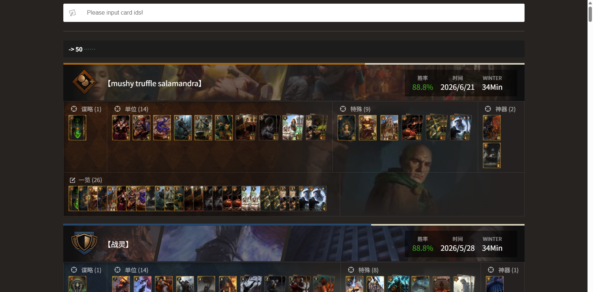

# GwentMirror · 卡组镜像站前端

Vue 3 + Vite + Element Plus 的昆特牌卡组站：按卡牌组合检索卡组、卡组详情、悬浮卡牌大图。
构建产物由 nginx 直接托管，接口统一走 `/gmapi` 反代到后端。

> 本目录是 [gwent-mirror-all](https://github.com/1053278842/GwentMirrorAllInOne) 一体化项目的前端层。
> 镜像里它被编译成静态文件放到 `/usr/share/nginx/html`。

站点演示（选牌 → 过滤 → 卡组详情，42 帧）：


静态截图（卡组检索首页）：



---

## 1. 页面

| 路由 | 组件 | 说明 |
| --- | --- | --- |
| `/` | — | 重定向到 `/search`（容器化时补的，原仓库没有根路由会白屏） |
| `/search` | `views/DeckSearchView.vue` | 主页面：顶部卡牌检索栏 + 卡组虚拟滚动列表 |
| `/home` | `views/HomeView.vue` | 早期原型：直接罗列几张卡（无样式，未接路由入口） |
| `/about` | `views/AboutView.vue` | 原型页 |
| `/test` | `views/手写固定高虚拟列表论文用.vue` | 虚拟列表的实验页 |

主页面交互：

1. 点输入框 → 展开卡牌下拉（1171 张，虚拟滚动 + 名称过滤）；
2. 选中的卡会变成输入框左侧的小卡牌 token，点 token 上的叉可移除；
3. 选牌后调 `getDecksByIds`，只显示「包含这些卡」的卡组，命中的那张牌在卡组里带橙色虚线框；
4. 没选牌时调 `getRandomDecksLast?num=50`，随机展示 50 套近期卡组；
5. 鼠标划过卡牌 → 浮出大图 + 技能描述（`CardView.vue` 手绘的卡框/战力/人口叠加）。


按卡牌过滤（选中 Geralt of Rivia 后命中 15 套，命中的牌带橙色虚线框）：


卡组详情（谋略 / 单位 / 特殊 / 神器 分组 + 势力背景）：


## 2. 技术栈与目录

```text
src/
├─ main.ts                    # 应用入口：Pinia / Router / Element Plus 图标 / 虚拟滚动插件
├─ App.vue                    # 顶部导航 + <RouterView>
├─ router/index.ts            # 路由表
├─ api/
│  ├─ gwentmirror.ts          # 后端接口（统一 'gmapi/...' 前缀）
│  └─ carddata.ts             # 官网接口（'api-pg/...'，现在没被使用）
├─ stores/
│  ├─ AllCards.ts             # allCard.json → Card 对象（含 imgUrl 拼装）
│  ├─ UserOperationStore.ts   # 已选卡牌集合（getIds() 拼成逗号串）
│  ├─ CardEnum.ts             # 势力/类型/稀有度/边框样式枚举
│  └─ status.ts               # 导航栏、搜索栏显隐
├─ views/                     # 页面与画布式卡牌渲染
├─ assets/
│  ├─ allCard.json            # 1171 张卡的数据（名称/战力/护甲/人口/类型/势力）
│  ├─ card/art/preview/…      # 2800+ 张卡图、卡框、数字图标
│  └─ other/FactionBg/…       # 势力背景原画
└─ types/                     # Card / Deck 类型
```

* **卡牌数据完全离线**：`allCard.json` 打包进产物，官网接口不可用也能正常渲染；
* **卡图路径是绝对路径**：CSS/JS 里写的是 `/src/assets/card/...`，所以构建时把源码的
  `src/assets` 目录原样复制到 `dist/src/assets`，和生产环境 URL 完全对齐（见 4 节）。

## 3. 本地开发

```bash
npm install
npm run dev          # http://localhost:5173
```

`vite.config.ts` 里三个代理：

| 前缀 | 目标 | 用途 |
| --- | --- | --- |
| `/gmapi` | `http://117.50.175.251:8081` | 作者的线上后端。**本地调试请改成 `http://localhost:8081`** |
| `/localapi` | `http://localhost:8081` | 本地后端（把 `api/gwentmirror.ts` 的前缀换成 `localapi` 即可） |
| `/api-pg` | `https://www.playgwent.com` | 官网数据（当前代码未使用） |

## 4. 构建

```bash
npx vite build        # 只编译，不做类型检查
npm run build         # = vue-tsc 类型检查 + vite build（历史代码有类型报错，会失败）
```

构建产物布局：

```text
dist/
├─ index.html
└─ src/assets/                 # 注意不是默认的 assets/，由 vite.config.ts 的 assetsDir 指定
   ├─ index-*.js / *.css       # 打包后的代码
   └─ card/… other/…           # 从 src/assets 原样拷进来的卡图素材
```

> 为什么要手动拷 `src/assets`：`CardView.vue` 等文件里用的是
> `background-image: url("/src/assets/card/art/preview/...")` 这种**绝对路径**，
> 这些文件没有被 import，Vite 不会替你搬。镜像的 Dockerfile 里有一行
> `cp -r src/assets/. dist/src/assets/` 完成这件事。

## 5. 容器里怎么跑

* nginx 直接把 `dist` 作为站点根目录，SPA 路由用 `try_files $uri /index.html` 回退；
* `/gmapi/` 反代到同容器内的 `127.0.0.1:8081`（去掉前缀）；
* `/api-pg/` 反代到 `www.playgwent.com`（离线环境不可用，但页面不依赖它）。

## 6. 相对上游改的地方

| 文件 | 问题 | 处理 |
| --- | --- | --- |
| `src/views/CardSearchView.vue` | HEAD 版本把整个 `DeckSearchView` 复制了过来，还 `import` 了自己（组件自我嵌套），首页顶部无限嵌套渲染、整页元素重叠 | 恢复成提交 `710ddc1` 里的原始「卡牌检索栏」实现 |
| `src/views/DeckSearchView.vue` | 模板多了一个 `</template>`，`vite build` 直接报 `Element is missing end tag` | 删掉多余结束标签 |
| `src/views/DeckSearchView.vue` | `loading` 只置 `true` 从不置 `false`，全屏 LOADING 遮罩永久盖住页面 | 数据到达/请求失败时关闭遮罩 |
| `src/views/CardView.vue` | 20 处 `url("src/assets/...")` 缺开头的 `/`，生产环境解析成 `/src/assets/src/assets/...` 全部 404 | 统一改成 `url("/src/assets/...")` |
| `index.html` | `lang="en"` 触发浏览器自动翻译，卡牌英文原文被机翻破坏 | 改 `lang="zh-CN"` + `translate="no"` |
| `src/router/index.ts` | 没有 `/` 路由，直接访问根路径白屏 | 增加 `/ → /search` 重定向 |
| `src/assets/main.css` | 没重置 `body` 外边距，铺满视口时有一圈白边 | 追加 `html,body{margin:0}` 等少量容器化样式 |

## 7. 还没做/已知问题

* 只有「按卡牌包含」一种检索，没有按势力/作者/人口区间筛选；
* `/home`、`/about`、`/test` 是早期原型页，没有接入导航；
* 卡组列表用 `vue-virtual-scroller` + 变高估算，窗口尺寸剧烈变化时偶发滚动错位，刷新恢复。