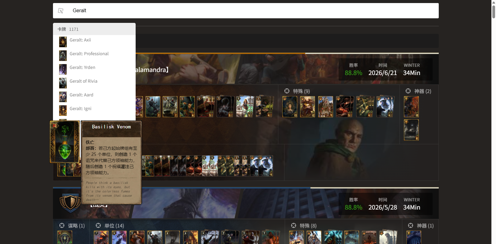
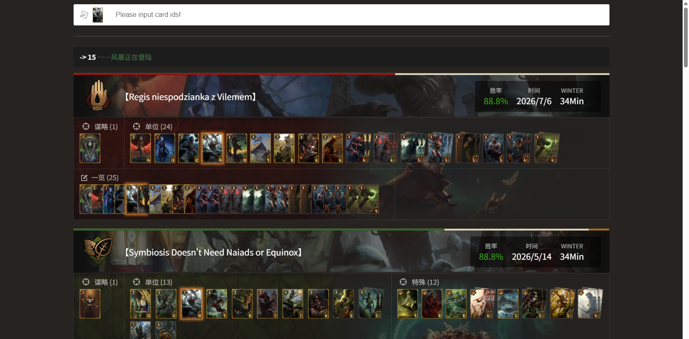
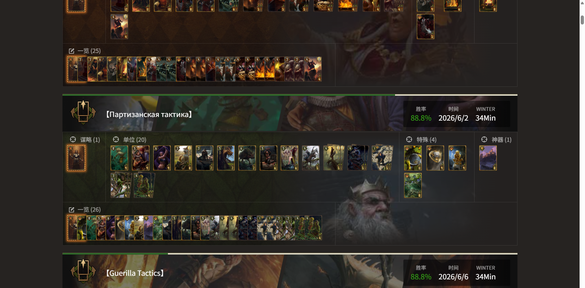

# 页面、技术栈与目录

## 页面

| 路由 | 组件 | 说明 |
| --- | --- | --- |
| `/` | — | 重定向到 `/search`（容器化时补的，原仓库没有根路由会白屏） |
| `/search` | `views/DeckSearchView.vue` | 主页面：顶部卡牌检索栏 + 卡组虚拟滚动列表 |
| `/home` | `views/HomeView.vue` | 早期原型：直接罗列几张卡（无样式，未接路由入口） |
| `/about` | `views/AboutView.vue` | 原型页 |
| `/test` | `views/手写固定高虚拟列表论文用.vue` | 虚拟列表的实验页 |

主页面交互：

1. 点输入框 → 展开卡牌下拉（1171 张，虚拟滚动 + 名称过滤）；
2. 选中的卡会变成输入框左侧的小卡牌 token，点 token 上的叉可移除；
3. 选牌后调 `getDecksByIds`，只显示「包含这些卡」的卡组，命中的那张牌在卡组里带橙色虚线框；
4. 没选牌时调 `getRandomDecksLast?num=50`，随机展示 50 套近期卡组；
5. 鼠标划过卡牌 → 浮出大图 + 技能描述（`CardView.vue` 手绘的卡框/战力/人口叠加）。



按卡牌过滤（选中 Geralt of Rivia 后命中 15 套，命中的牌带橙色虚线框）：



卡组详情（谋略 / 单位 / 特殊 / 神器 分组 + 势力背景）：



## 技术栈

| 依赖 | 版本 | 用途 |
| --- | --- | --- |
| Vue | 3.2 | 组合式 API + `<script setup>` |
| Vite | 4.x | 构建与 dev server（`assetsDir: 'src/assets'`） |
| Element Plus | 2.2 | 图标与少量控件（按需自动导入） |
| Pinia | 2.0 | 卡牌表、已选卡牌、界面状态 |
| vue-router | 4.1 | history 模式，nginx `try_files` 回退 |
| vue-virtual-scroller | 2.0-beta | 卡组与卡牌下拉的虚拟滚动 |

## 目录

```text
src/
├─ main.ts                    # 应用入口：Pinia / Router / Element Plus 图标 / 虚拟滚动插件
├─ App.vue                    # 顶部导航 + <RouterView>
├─ router/index.ts            # 路由表
├─ api/
│  ├─ gwentmirror.ts          # 后端接口（统一 'gmapi/...' 前缀）
│  └─ carddata.ts             # 官网接口（'api-pg/...'，现在没被使用）
├─ stores/
│  ├─ AllCards.ts             # allCard.json → Card 对象（含 imgUrl 拼装）
│  ├─ UserOperationStore.ts   # 已选卡牌集合（getIds() 拼成逗号串）
│  ├─ CardEnum.ts             # 势力/类型/稀有度/边框样式枚举
│  └─ status.ts               # 导航栏、搜索栏显隐
├─ views/                     # 页面与画布式卡牌渲染
├─ assets/
│  ├─ allCard.json            # 1171 张卡的数据（名称/战力/护甲/人口/类型/势力）
│  ├─ card/art/preview/…      # 2800+ 张卡图、卡框、数字图标
│  └─ other/FactionBg/…       # 势力背景原画
└─ types/                     # Card / Deck 类型
```

## 两个关键约定

**卡牌数据完全离线**：`allCard.json` 打包进产物，官网接口不可用也能正常渲染。
`stores/AllCards.ts` 启动时把 JSON 摊平成 `cardData` 数组与 `cardDataMap` 字典，
`Card.imgUrl` 在这一步拼好。

**卡图路径是绝对路径**：CSS/JS 里写的是 `/src/assets/card/...`，
所以构建时把源码的 `src/assets` 目录原样复制到 `dist/src/assets`，和生产环境 URL 完全对齐
（见 [getting-started.md](getting-started.md#构建)）。

## 渲染代码为什么这么写

`CardView.vue` 不是用一张整图，而是把卡面拆成图层：卡图 + 卡框（金/铜）+ 战力角标 +
人口角标 + 护甲 + 稀有度宝石，全部用 CSS 背景图叠出来。这样做的好处是同一套卡图能渲染
「小卡 / 中卡 / 大图 / 悬浮详情」四种尺寸，而不用为每种尺寸准备一套图片。

代价是 CSS 很长（约 18 KB），且所有背景图路径必须是绝对路径——这也是上面那条约定的由来。